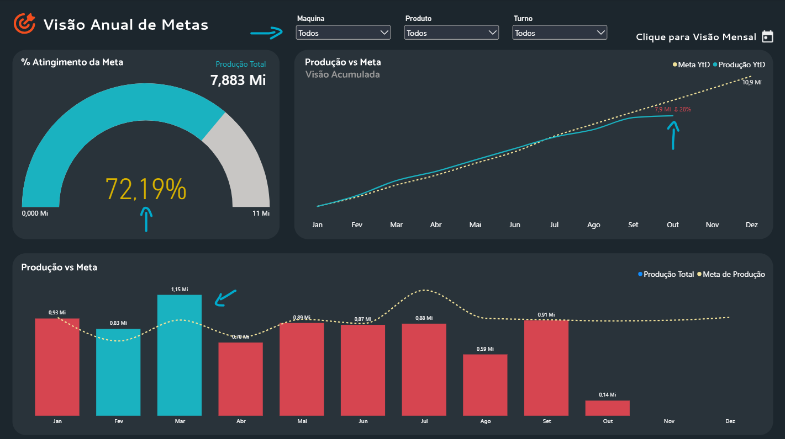
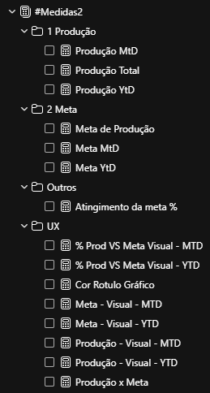
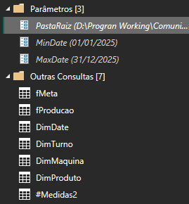
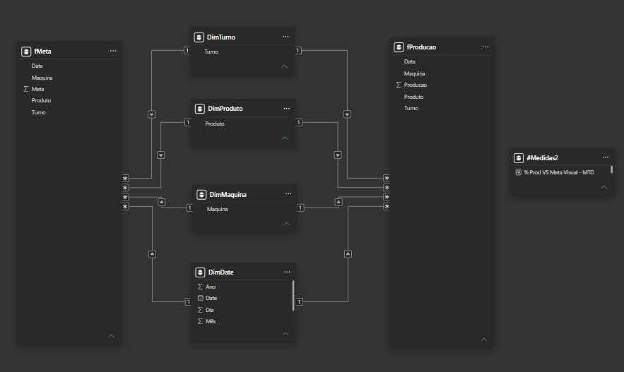

Projeto desenvolvido seguindo orientações de professores da comunidade de análise de dados **Bruce Fonseca**.

---

- Veja o email solicitação de projeto fictício [aqui](./solicitacao_projeto_metas.pdf)
- Acesse ao projeto power bi desenvolvido em power bi [aqui](./dashboard-acompanhamento-produção-vs-metas.pbip)
- Acesse ao dashboard final [aqui](https://app.powerbi.com/view?r=eyJrIjoiYTBhYjI2ZGMtZTJjMC00NzJhLThiNTMtY2NhZTRhN2UxZGViIiwidCI6IjY1OWNlMmI4LTA3MTQtNDE5OC04YzM4LWRjOWI2MGFhYmI1NyJ9)

# Desenvolvimento do projeto

## User Experience (UX)

O dashboard apresenta um <b>layout interativo e intuitivo</b>, com botões de navegação, indicadores visuais e elementos gráficos organizados para facilitar a interpretação dos dados. A interface foi desenvolvida com foco na experiência do usuário (UX), proporcionando uma navegação clara, acesso prático às informações e uma visualização objetiva dos principais indicadores de desempenho.

<table>
  <tr>
    <td width="100%" align="center" valign="top">
      
    </td>
  </tr>
</table>

## Medidas DAX

<table>
  <tr>
    <td width="55%" valign="top">
      

        O projeto conta com um conjunto de medidas <b>DAX</b> personalizadas para análise de desempenho produtivo, contemplando indicadores de produção, acompanhamento de metas e inteligência temporal. Foram desenvolvidas métricas para diferentes períodos, como <b>MTD</b> (acumulado no mês) e <b>YTD</b> (acumulado no ano), permitindo acompanhar os resultados e compará-los com os objetivos estabelecidos.
      

      

        <b>Também foram implementados indicadores percentuais de atingimento de metas</b>, além de medidas específicas para integração com elementos visuais e aprimoramento da experiência do usuário. A estrutura foi organizada em categorias funcionais, facilitando a manutenção das medidas, a reutilização dos cálculos e a construção de análises dinâmicas e intuitivas no Power BI.
      

    </td>
    <td width="25%" align="center" valign="top">
      
    </td>
  </tr>
</table>

## Importação de dados

<table>
  <tr>
    <td width="55%" valign="top">
        

        O processo de importação de dados foi estruturado com parâmetros personalizados para facilitar a configuração e a atualização das informações, incluindo a definição de caminhos de origem e intervalos de datas. Também foram aplicadas boas práticas de tipagem de dados e organização das consultas, contribuindo para a consistência e a manutenção do projeto.
        

        

        Na modelagem de dados, foi desenvolvido um relacionamento entre a tabela fato de produção e as tabelas dimensão de data, turno, produto e máquina. Essa estrutura permite organizar as informações de forma analítica, estabelecer relacionamentos entre as entidades e viabilizar análises dinâmicas por diferentes perspectivas.
        

    </td>
    <td width="35%" align="center" valign="top">
      
    </td>
  </tr>
</table>

<table>
    <td width="55%" valign="top">
    

        A separação entre fatos e dimensões contribui para uma estrutura mais organizada e facilita a construção de indicadores, o cruzamento de informações e a aplicação de filtros nos relatórios.
        

         
    </td>
</table>

